<h2>TensorFlow-FlexUNet-Image-Segmentation-FracAtlas-Fracture (2026/10/15)</h2>
Sarah T. Arai 
Software Laboratory antillia.com  

This is the first experiment of Image Segmentation for <b>FracAtlas-Fracture </b>
 based on
our <a href="https://github.com/sarah-antillia/TensorFlow-FlexUNet-Image-Segmentation-Model">TensorFlowFlexUNet Model</a>
 (<b>TensorFlow Flexible UNet Image Segmentation Model for Multiclass</b>) and a 512x512-pixel cropped PNG
 <a href="https://drive.google.com/file/d/1iOIJBXknScpadLazpjVnEFaz9qoupuxD/view?usp=sharing">
Augmented-FracAtlas-Fracture-ImageMask-Dataset.zip</a> 
(<a href="https://creativecommons.org/licenses/by-nc-sa/4.0/">CC BY-NC-SA 4.0</a>
), 
which was derived by us from the Kaggle  
  
<a href="https://www.kaggle.com/datasets/shyamgupta196/fracatlas/data">
<b>FracAtlas Annotated Fracture Imagesn</b>
</a> by SHYAM GUPTA.
  

<b>Actual Image Segmentation for FracAtlas-Fracture Images of 512x512 pixels</b> 
As shown below, the inferred masks resemble the ground-truth masks exceot for the third case.  
 
<table>
<tr>
<th width="320" height="auto">Input: image</th>
<th width="320" height="auto">Mask (ground_truth)</th>
<th width="320" height="auto">Prediction: inferred_mask</th>
</tr>
<tr>
<td>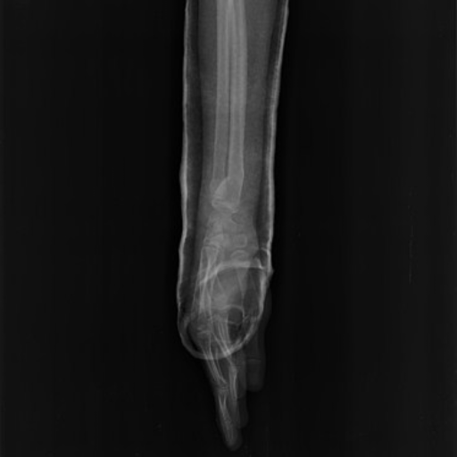</td>
<td></td>
<td></td>
</tr>
<tr>
<td>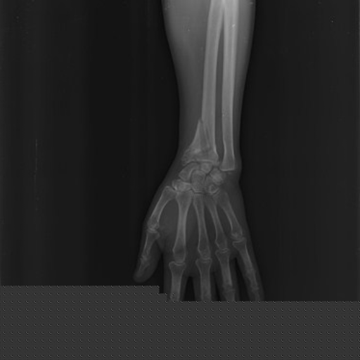</td>
<td>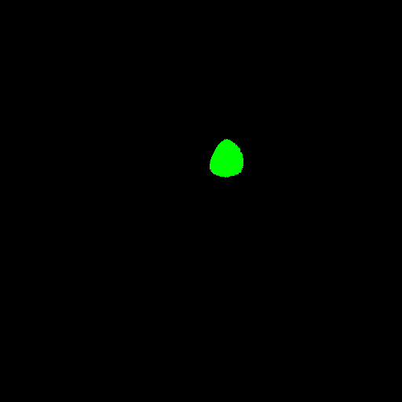</td>
<td></td>
</tr>
<tr>
<td>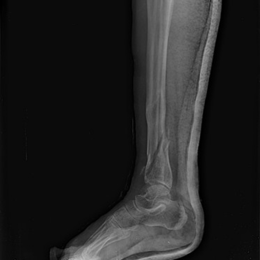</td>
<td>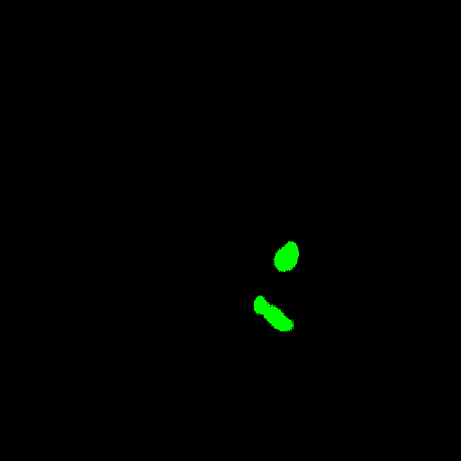</td>
<td></td>
</tr>
</table>

 
<h3>1. Dataset Citation</h3>
The dataset used here was derived from the following Kaggle:  
<a href="https://www.kaggle.com/datasets/shyamgupta196/fracatlas/data">
<b>FracAtlas Annotated Fracture Imagesn</b>
</a>  
Comprehensive Collection of Fracture Images for Medical Research and Analysis
 
by SHYAM GUPTA.
  
The following explanation was taken from the website above  
<b>About Dataset</b> 
The majority of the existing X-Ray datasets are either very small in size to be used in training machine 
learning models or lack proper annotation to be used in localization and segmentation. 
This creates a limitation while comparing different state-of-the-art (SOTA) methods as each study uses 
its own set of data that is not made public. It also hinders the development of machine-learning algorithms 
for classification, localization and segmentation. In this work, we introduce a new dataset of more than 
14,000 X-Ray scans which was collected from 3 major hospitals in Bangladesh.  
From this raw data, we isolated 4,083 images which have been manually annotated for classification, 
localization and segmentation of bone fractures with the help of 2 expert radiologists and later validated 
by a medical officer. Each scan in the dataset was independently labeled by both radiologists and later 
confirmed by the medical officer.  
The annotation was done with the help of makesense.ai, an open-source labeling platform. 
All the scans are available in JPG format along with proper annotations.
  
<b>Citation</b> 
<pre>
@article { Abedeen_2023,
  title = {{FracAtlas}: A Dataset for Fracture Classification, Localization and Segmentation 
            of Musculoskeletal Radiographs},
  author = {Iftekharul Abedeen and Md. Ashiqur Rahman and Fatema Zohra Prottyasha and Tasnim Ahmed and 
             Tareque Mohmud Chowdhury and Swakkhar Shatabda},
  year = 2023,
  month = {aug},
  journal = {Scientific Data},
  publisher = {Springer Science and Business Media {LLC}},
  volume = 10,
  number = 1,
  doi = {10.1038/s41597-023-02432-4},
  url = {https://doi.org/10.1038%2Fs41597-023-02432-4}
}
</pre>
 
<b>License</b> 
<a href="https://creativecommons.org/licenses/by-nc-sa/4.0/">CC BY-NC-SA 4.0</a>
 
 
<h3>
2 FracAtlas-Fracture Ultrasound ImageMask Dataset
</h3>
<h3>2.1 Download ImageMask Dataset</h3>
 If you would like to train this FracAtlas-Fracture Segmentation model,
 please download the dataset from Google Drive  
 <a href="https://drive.google.com/file/d/1iOIJBXknScpadLazpjVnEFaz9qoupuxD/view?usp=sharing">
Augmented-FracAtlas-Fracture-ImageMask-Subset.zip</a>. 
Expand the downloaded ImageMaskDataset and put it under the <b>./dataset</b> folder.
 
<pre>
./dataset
└─FracAtlas-Fracture
    ├─test
    │   ├─images
    │   └─masks
    ├─train
    │   ├─images
    │   └─masks
    └─valid
         ├─images
         └─masks
</pre>
 
<b>FracAtlas-Fracture Statistics</b> 
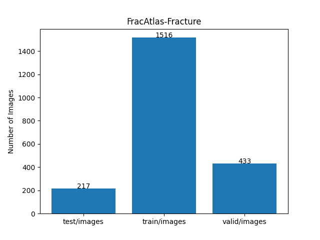 
 
As shown above, the number of images in the training and valid datasets is large enough to use for the
 training set of our segmentation model.
 
<h3>2.2 Derivation of ImageMask Dataset</h3>
The folder structure of the original facture dataset  
</a> is as follows.
<pre>
./facture
 ├─test
 │   ├─ann  ( 61 JSON files)
 │   │
 │   └─img  ( 61 JPG files)
 ├─train
 │   ├─ann  (574 JSON files)
 │   │
 │   └─img  (574 JPG files)
 │ 
 └─val   
      ├─ann  ( 82 JSON files)
      │
      └─img  ( 82 JPG files)
</pre>
<b>Step 1</b> 
We geneated a 512x512-pixel cropped ImageMask dataset from the original JPG files and <b>polygon points exterior data</b> 
in corresponding JSON annotation files in test, train and val subfolders.
  
<b>Step 2</b> 
As shown above, the number of JPG and the corresponding JSON annotation files is small to use as a training dataset
of our segmentation model. Therefore, we generated our own augmented dataset from the cropped ImageMask dataset
by applying classic flipping and rotating operations to the cropped one.
  
<b>Step 3</b> 
We generated a pretrained FlexUNet model by using the augmented dataset obtained in <b>Step 2</b>.
  
<b>Step 4</b> 
We generated the second masks from the cropped images by applying a segmentation method of the 
pretrained FlexUNet model.
  
<b>Step 5</b> 
We finally generated the second <a href="https://drive.google.com/file/d/1iOIJBXknScpadLazpjVnEFaz9qoupuxD/view?usp=sharing">Augmented-FracAtlas-Faction-ImageMaskDataset</a>
from all pairs of the cropped images and the corresponding second masks by applying 
flipping and rotating augmentation tools to the pairs.
  

<h3>2.3 Train Sample Images and Masks</h3>
<b>Train_sample_images</b> 
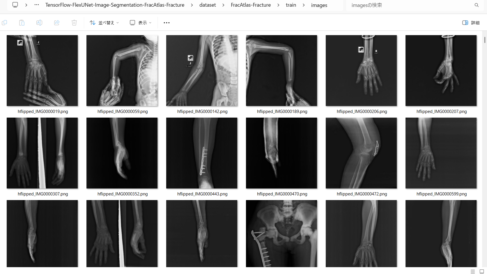
 
<b>Train_sample_masks</b> 
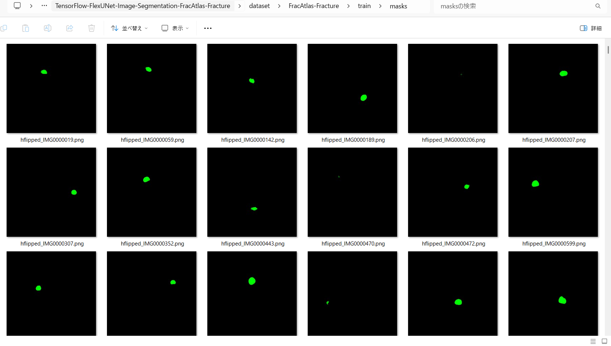
 

<h3>
3 Train TensorFlowFlexUNet Model
</h3>
 We trained the FracAtlas-Fracture TensorFlowFlexUNet model using the following
<a href="./projects/TensorFlowFlexUNet/FracAtlas-Fracture/train_eval_infer.config"> <b>train_eval_infer.config</b></a> file.  
Please move to ./projects/TensorFlowFlexUNet/FracAtlas-Fracture and run the following bat file. 
<pre>
>1.train.bat
</pre>
This runs the following command. 
<pre>
>python ../../../src/TensorFlowFlexUNetTrainer.py ./train_eval_infer.config
</pre>

<b>Model parameters</b> 
Defined a small <b>base_filters=16 </b> and large <b>base_kernels=(11,11)</b> for the first Conv Layer of Encoder Block of 
<a href="./src/TensorFlowFlexUNet.py">TensorFlowFlexUNet.py</a> 
and a large <b>num_layers=8</b> (including a bridge between Encoder and Decoder Blocks).
<pre>
[model]
; You may specify your own UNet class derived from our TensorFlowFlexModel
model         = "TensorFlowFlexUNet"
generator     =  False
image_width    = 512
image_height   = 512
image_channels = 3
num_classes    = 2
base_filters   = 16
base_kernels   = (11,11)
num_layers     = 8
dropout_rate   = 0.04
; Specified a large dilation.
dilation       = (3,3)
</pre>
<b>Learning rate</b> 
Defined a small learning rate.  
<pre>
[model]
learning_rate  = 0.00007
</pre>
<b>Loss and metrics functions</b> 
Specified "categorical_focal_dice_loss" and <a href="./src/dice_coef_multiclass.py">"dice_coef_hybrid"</a>. 
<pre>
[model]
loss           = "categorical_focal_dice_loss"
metrics        = ["dice_coef_hybrid"]
hybrid_alpha   = 1.6
hybrid_beta    = 0.4
</pre>
<b>Dataset class</b> 
Specifed <a href="./src/ImageCategorizedMaskDataset.py">ImageCategorizedMaskDataset</a> class. 
<pre>
[dataset]
class_name    = "ImageCategorizedMaskDataset"
</pre>
 
<b>Learning rate reducer callback</b> 
Enabled the learning_rate_reducer callback and a small reducer_patience.
<pre> 
[train]
learning_rate_reducer = True
reducer_factor     = 0.4
reducer_patience   = 4
</pre>
<b>Early stopping callback</b> 
Enabled early stopping callback with the patience parameter.
<pre>
[train]
patience      = 10
</pre>

<b>RGB Color map</b> 
Specified RGB color map dict for FracAtlas-Fracture 2 classes. 
<pre>
[mask]
mask_datatype= "categorized"
mask_file_format = ".png"
; FracAtlas-Fracture RGB color map dict for 1+1 classes.
;      Background: black, Fracture: green
rgb_map = {(0,0,0):0,(0,255,0):1,}
</pre>

<b>Epoch change inference callback</b> 
Enabled <a href="./src/EpochChangeInferencer.py">epoch_change_infer callback</a></b>. 
<pre>
[train]
epoch_change_infer       = True
epoch_change_infer_dir   =  "./epoch_change_infer"
num_infer_images         = 6
</pre>

By using this callback, on every epoch change, the inference procedure can be called
 for 6 images in the <b>mini_test</b> folder. This will help you confirm how the predicted mask changes 
 at each epoch during your training process.  
  
As shown below, early in the model training, the predicted masks from our FlexUNet segmentation model showed 
discouraging results.
 However, as training progressed through the epochs, the predictions gradually improved. 
   
 
<b>Epoch_change_inference output at starting (epoch 1,2,3)</b> 
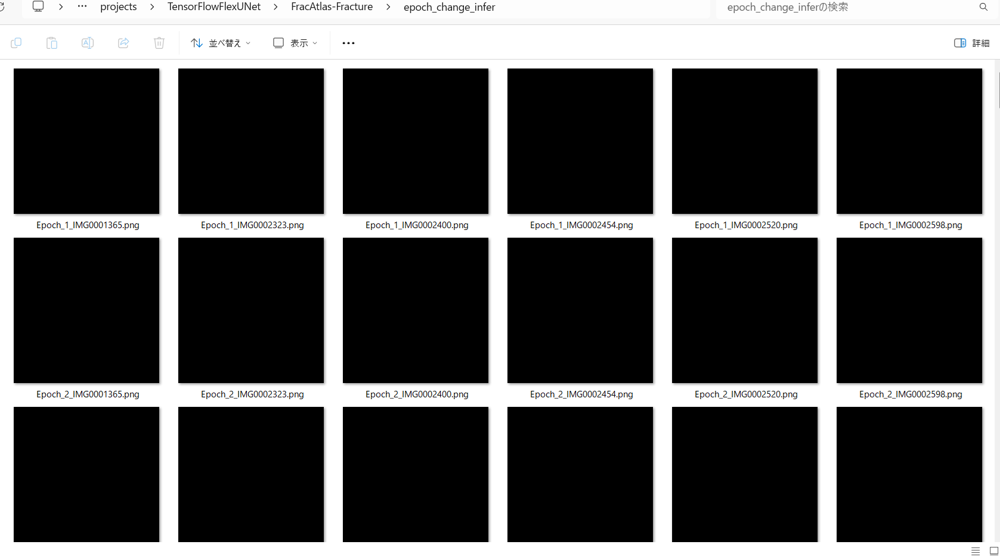 
 
<b>Epoch_change_inference output at middlepoint (epoch 16,17,18)</b> 
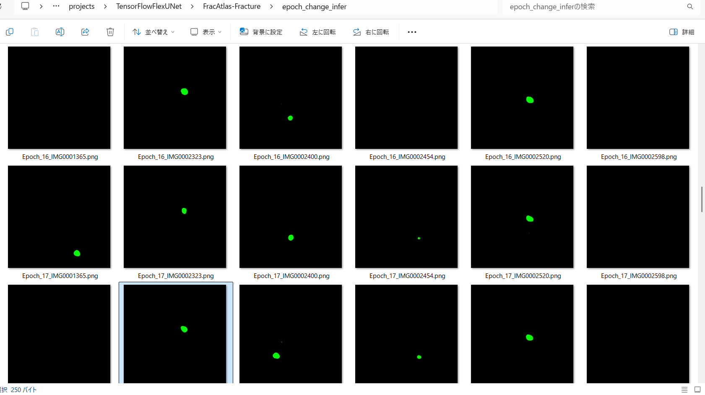 
 
<b>Epoch_change_inference output at ending (epoch 34,35,36)</b> 
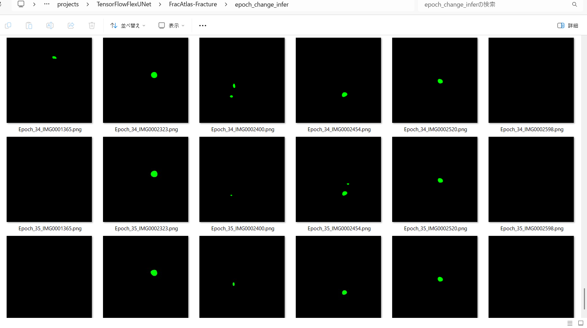 
 
In this experiment, the training process was stopped at epoch 31 by EarlyStoppingCallback. 
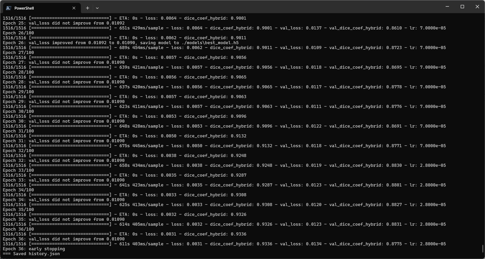 
 
<a href="./projects/TensorFlowFlexUNet/FracAtlas-Fracture/eval/train_metrics.csv">train_metrics.csv</a> 
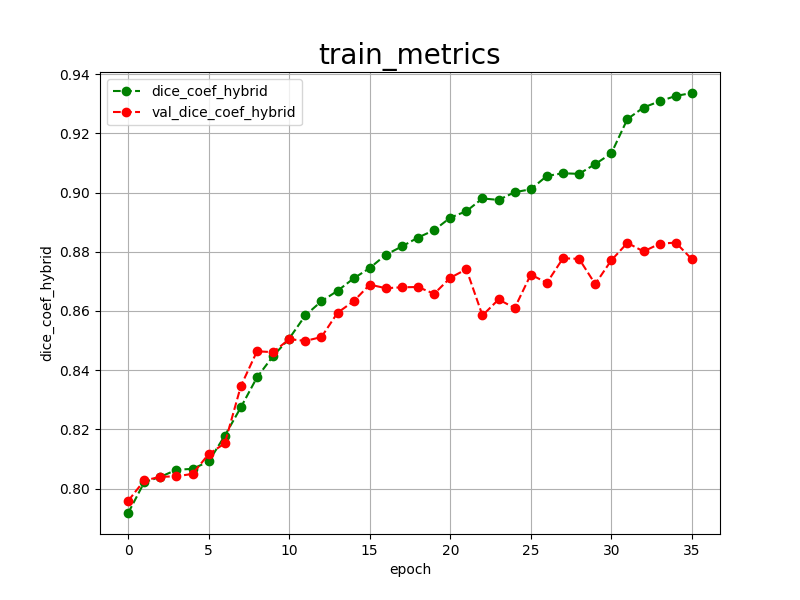 
 
<a href="./projects/TensorFlowFlexUNet/FracAtlas-Fracture/eval/train_losses.csv">train_losses.csv</a> 
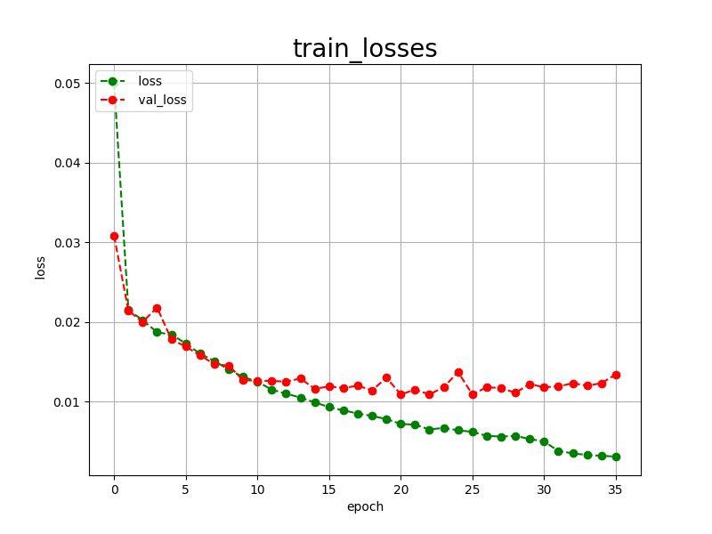 
 
<h3>
4 Evaluation
</h3>
Please move to <b>./projects/TensorFlowFlexUNet/FracAtlas-Fracture</b> folder, 
and run the following bat file to evaluate the TensorFlowUNet model for FracAtlas-Fracture. 
<pre>
./2.evaluate.bat
</pre>
This runs the following command.
<pre>
python ../../../src/TensorFlowFlexUNetEvaluator.py ./train_eval_infer.config
</pre>

Evaluation console output: 
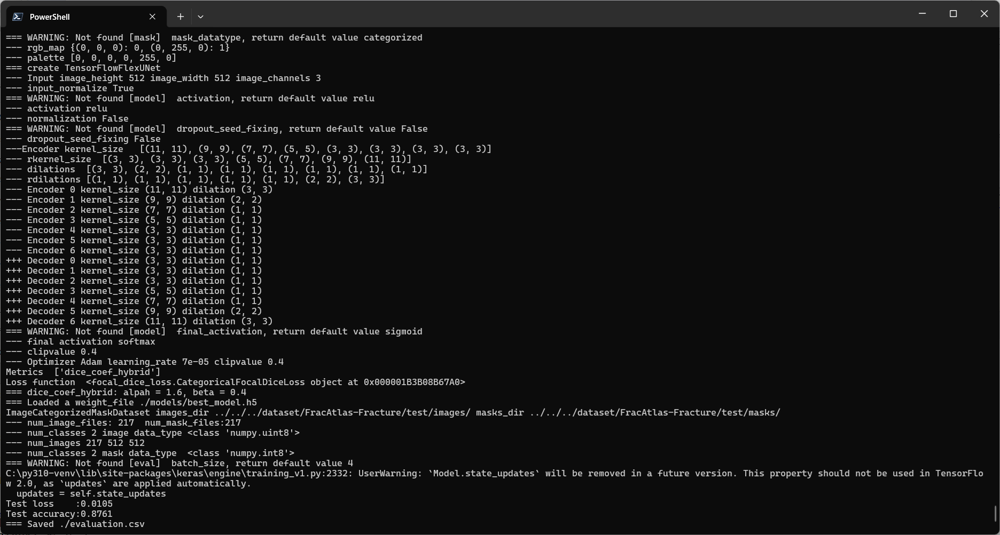
  Image-Segmentation-FracAtlas-Fracture

<a href="./projects/TensorFlowFlexUNet/FracAtlas-Fracture/evaluation.csv">evaluation.csv</a> 
The loss (categorical_focal_dice_loss) on this FracAtlas-Fracture/test was low, but dice_coef_hybrid was not high, as shown below.
 
<pre>
categorical_focal_dice_loss,0.0105
dice_coef_hybrid,0.8761</pre>
 

<h3>
5 Inference
</h3>
Please move to <b>./projects/TensorFlowFlexUNet/FracAtlas-Fracture</b> folder
and run the following bat file to infer segmentation regions for images using the trained TensorFlowUNet model for FracAtlas-Fracture. 
<pre>
./3.infer.bat
</pre>
This runs the following command.
<pre>
python ../../../src/TensorFlowFlexUNetInferencer.py ./train_eval_infer.config
</pre>

<b>mini_test_images</b> 
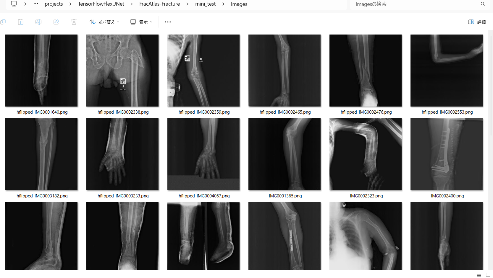 
<b>mini_test_mask(ground_truth)</b> 
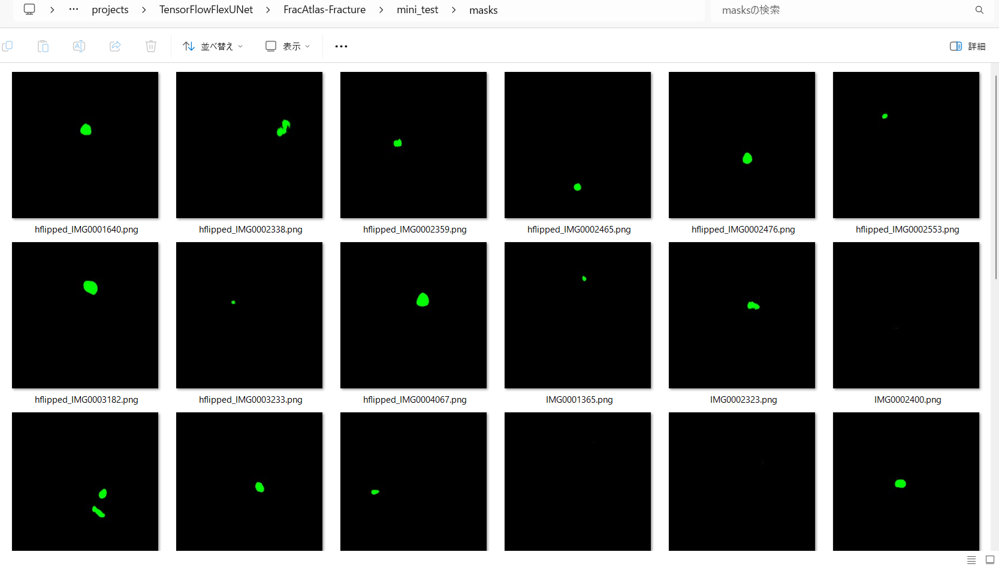 

<b>Inferred test masks</b> 
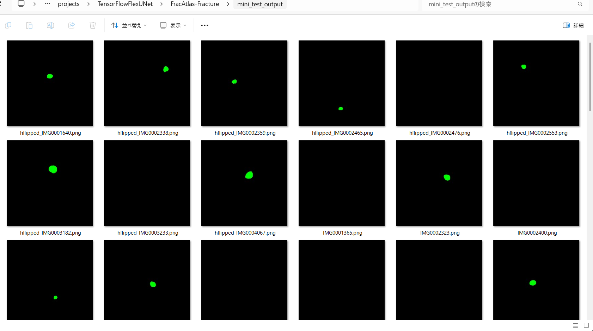 
 

<b>Enlarged images and masks for FracAtlas-Fracture Images of 512x512 pixels</b> 
As shown below, the inferred masks look similar to the ground truth masks except for the first and second cases. 
 
<table>
<tr>
<th width="320" height="auto">Image</th>
<th width="320" height="auto">Mask (ground_truth)</th>
<th width="320" height="auto">Inferred-mask</th>
</tr>
<tr>
<td>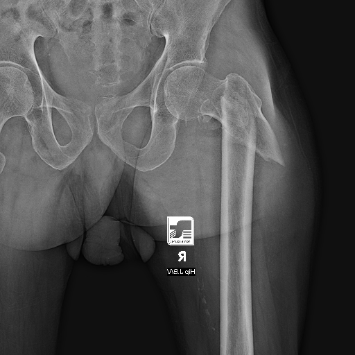</td>
<td>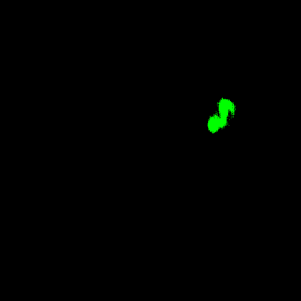</td>
<td></td>
</tr>
<tr>
<td>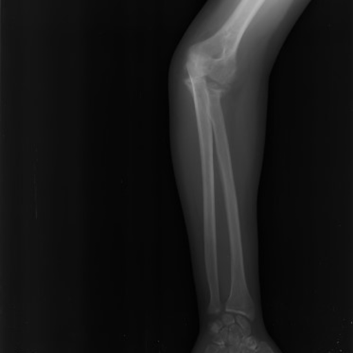</td>
<td></td>
<td></td>
</tr>
<tr>
<td>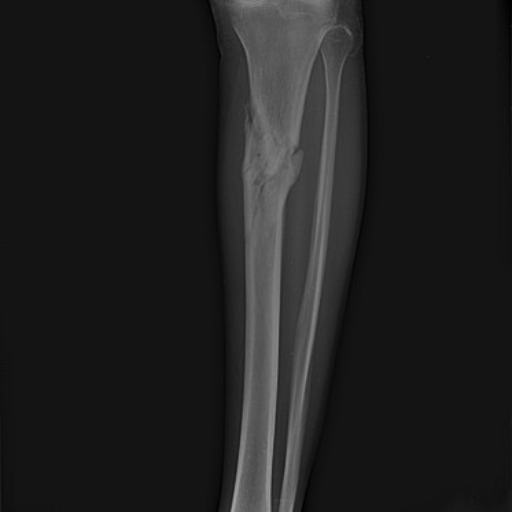</td>
<td>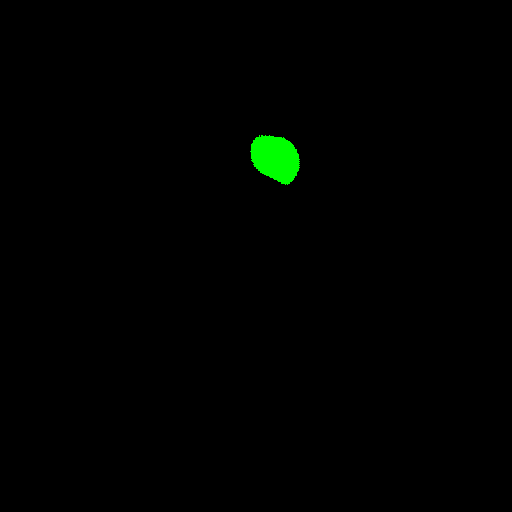</td>
<td></td>
</tr>
<tr>
<td>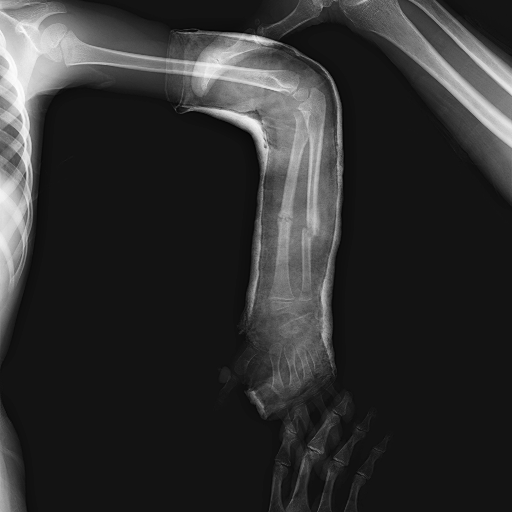</td>
<td>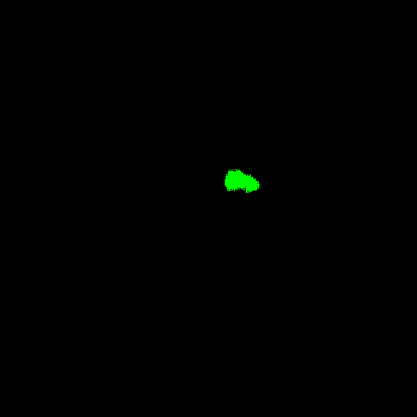</td>
<td></td>
</tr>
<tr>
<td>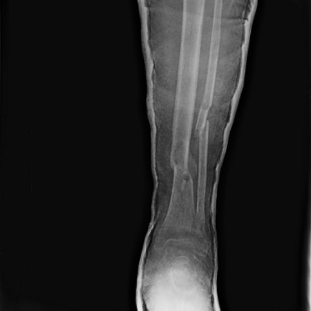</td>
<td></td>
<td></td>
</tr>
<tr>
<td>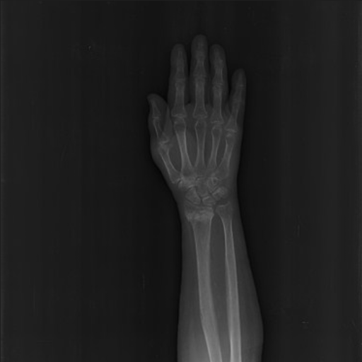</td>
<td></td>
<td></td>
</tr>
</table>

 
<h3>
References
</h3>
<b>1. FracAtlas: A Dataset for Fracture Classification, Localization and Segmentation of Musculoskeletal 
Radiographs</b> 
Iftekharul Abedeen, Md. Ashiqur Rahman, Fatema Zohra Prottyasha, Tasnim Ahmed,  
 Tareque Mohmud Chowdhury & Swakkhar Shatabda  
<a href="https://www.nature.com/articles/s41597-023-02432-4">https://www.nature.com/articles/s41597-023-02432-4</a>
  
<b>2. The impact of implementing backbone architectures on fracture segmentation in X-ray images</b> 
Salih Turk, Ozkan Bingol, Ahmet Coskuncay, Tolga Aydin 
<a href="https://www.sciencedirect.com/science/article/pii/S2215098624002696">
https://www.sciencedirect.com/science/article/pii/S2215098624002696</a>
  
<b>3. WCAY object detection of fractures for X-ray images of multiple sites</b> 
Peng Chen, Songyan Liu, Wenbin Lu, Fangpeng Lu, Boyang Ding 
<a href="https://pmc.ncbi.nlm.nih.gov/articles/PMC11535499/">https://pmc.ncbi.nlm.nih.gov/articles/PMC11535499/</a>
  
<b>4. TensorFlow-FlexUNet-Image-Segmentation-Model</b> 
Toshiyuki Arai 
<a href="https://github.com/sarah-antillia/TensorFlow-FlexUNet-Image-Segmentation-Model">
https://github.com/sarah-antillia/TensorFlow-FlexUNet-Image-Segmentation-Model
</a>
  
